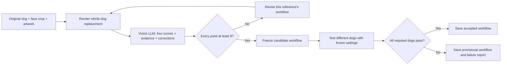

# Consistent Pet

**Next LLM: read [HANDOFF.md](HANDOFF.md) first.** It locates all **725 unique portrait references**, their GitHub/Hugging Face downloads, and the [725 per-picture GPU workflow folders](workflows/portraits/index.json). It directs the RTX 6000 refinement work and explains exactly where to save each validated workflow.

Local, feedback-driven pet portrait refinement on a 96 GB RTX PRO 6000 Blackwell.
The system renders a pet in a reference artwork, asks an independent vision LLM
to diagnose the result, changes that reference's workflow and tries again.

**Acceptance: face, fur, body and design must each score at least 9/10**, with
high reviewer confidence and no major defects. An overall average cannot hide
a weak body or an incorrect coat.



This improves **generation workflows**, not model weights. The vision model's
rubric and weights stay fixed throughout a run. AI scores remain estimates of
quality, not a guarantee of a perfect likeness or print readiness.

## What is implemented

- Per-reference iteration using structured LLM evidence and proposed corrections.
- Whole-animal and costume segmentation, removal of the old pet from the design
  reference, generative inpainting and preservation of unmasked background pixels.
- Changes to repair-region size, source/face/design reference resolution, sampling
  steps, guidance, seed and correction instructions. The critic never executes code.
- Dog-specific feedback applies only to the dog the critic actually reviewed.
  A correction for one dog's coat is not transferred to a different dog.
- Two tuning dogs, three separate validation dogs and two final test dogs. The
  final dogs run only after tuning and validation pass. Their results never feed
  back into candidate selection in that run.
- Saved native ComfyUI graphs, exact output hashes, assessments, change history,
  frozen workflows and an accepted-workflow registry.
- Resume using the saved native job ID; ambiguous submissions stop for inspection
  instead of silently generating duplicates.
- A live, token-protected review page with original dog, prepared dog, reference,
  output, AI scores, workflow changes and optional human ratings/notes.

Retries stop at the configured generation/time limit or stagnation limit. A
below-target result is retained as provisional and never mislabeled accepted.
The current three-reference pilot uses up to eight recipes per reference, 90
renders and six hours. It has not established that every reference can reach 9.

## Stack

The deployed graph uses FLUX.2 klein base 4B, SAM3.1 segmentation and
Qwen3-VL-32B-Instruct for independent visual review. Models are installed locally;
there is no paid image-generation API in this loop. The baseline is an API-format
ComfyUI graph, not a GUI workflow export.

See [setup](docs/SETUP.md) for the installed model filenames and environment, and
[workflow behavior](docs/WORKFLOW.md) for state, acceptance and artifact details.

## Run

Use Linux with a working, compatible ComfyUI installation and the model weights
already installed. First create a **private** manifest from
[the example](examples/manifest.example.json), supplying at least seven distinct
dogs, their real face crops and the reference artwork files.

```bash
python -m pip install -r requirements.txt
export FPG_REVIEW_ROOT=/workspace/consistent-pet-runtime
export COMFY_API=http://127.0.0.1:18188
export COMFY_INPUT_DIR=/workspace/ComfyUI/input

python scripts/init-portrait-lab.py \
  --manifest /private/pet-manifest.json --root "$FPG_REVIEW_ROOT"
python scripts/check-portrait-setup.py

# Separate supervised processes / terminals:
python scripts/score-portrait-outputs.py
python scripts/serve-investor-lab.py
python scripts/monitor-gpu.py

# Initialize the run; does not submit generation:
python scripts/run-portrait-autorefine.py --plan "$FPG_REVIEW_ROOT/plan.json"
# Start the feedback loop:
python scripts/run-portrait-autorefine.py --plan "$FPG_REVIEW_ROOT/plan.json" --run
```

The studio listens on localhost port 18300. Its private path is
`/view/<token>/`, with the generated token stored in the runtime directory.
Expose it through an authenticated HTTPS proxy or an operator-managed tunnel.
Keep an existing tunnel process running when deploying worker/page updates.

For an existing deployment, preserve its runtime directory, tokens, selected dogs
and model files. **Do not run the initializer against it.** Freeze a new runner
copy and choose a new run version when changing code or policy.

## Tests

```bash
python scripts/run-tests.py
node --check scripts/portrait-review-ui.js
```

The GPU runner is Linux-specific (`fcntl`). Its orchestration tests use explicit
generator/reviewer doubles; real GPU output quality is assessed separately.
Tests cover the per-dimension 9/10 gate, critique-driven edits, identity isolation,
frozen cross-dog validation, failure/budget behavior, masks, durable reviews and
private-runtime initialization.

## Repository contents

This repository contains the implementation, tests and generic workflow/config
examples. Customer photos, outputs, review databases, runtime plans, model weights,
private links and credentials are not source files. Successful runtime workflows
are saved privately; use the sanitized export described in the workflow guide to
publish a reusable configuration without its evaluation assets.

## Portrait reference library

The [reference library](reference-library/README.md) contains 725 Higgsfield portrait concepts organized by male, female and unisex costume eligibility across 63 categories, plus 100 vintage poster variants. These approved template assets are stored with Git LFS; customer uploads and generated customer portraits remain private and excluded.

Browse `reference-library/index.html` after cloning with Git LFS, or download the [Hugging Face dataset](https://huggingface.co/datasets/bensblueprints/consistent-pet). See its catalog for provenance, checksums and review flags. These references are not validated identity-transfer workflows.
